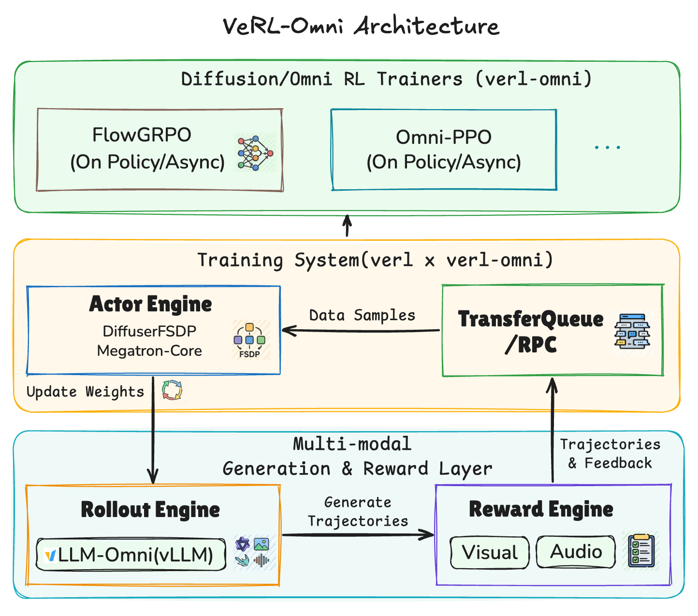

<div align="center">

# VeRL-Omni

### 面向扩散模型与全模态模型的简单易用、高效且稳定的强化学习训练框架

<a href="https://deepwiki.com/verl-project/verl-omni"></a>
[](https://verl-omni.readthedocs.io/en/latest/index.html)
[](./LICENSE) <a href="docs/assets/WeChat.jpg"></a> <a href="https://join.slack.com/t/verl-project/shared_invite/zt-4bb32of1g-c~szeecZ2fufGeSadsIefw"></a> <a href="https://drive.google.com/file/d/1EGVFZdvRgSBymMlZa62FObbzEhMoLA0F/view?usp=sharing"></a>

[English](./README.md) | **简体中文**

</div>

`VeRL-Omni` 是一个专注于多模态生成模型的通用强化学习（RL）训练框架，构建于开源强化学习库 [`verl`](https://github.com/verl-project/verl) 之上。

它源自 `verl` 在多模态生成强化学习方面的探索与实践，现已建立独立代码库，以便更加聚焦、敏捷地持续演进。

## 最新动态 🔥
- **[2026-10]** 🎉 我们正式发布了 [v0.3.0](https://github.com/verl-project/verl-omni/releases/tag/v0.3.0)，支持扩散模型与全模态模型的全异步强化学习，并将 v1 训练器设为默认配置。
- **[2026-10]** 正式支持 [OmniNFT](examples/omninft_trainer/README.md) 音视频后训练。[LTX2.3](examples/omninft_trainer/ltx2/README.md) 文本生成视频+音频 LoRA 配方现可在昇腾 NPU 上按模态路由优势。
- **[2026-09]** [v1 训练器](docs/start/diffusion_v1.md)（TransferQueue + ReplayBuffer）现已成为扩散模型的默认配置；旧版 v0 训练器已弃用，离线 DPO 按设计保持在 v0。
- **[2026-08]** 正式支持 **[DiffusionOPD](docs/algo/diffusion_opd.md)**（在线策略蒸馏 On-Policy Distillation，包含多教师 MOPD）。
- **[2026-08]** 🔥 **MiniMax-H3** 现已支持文生音画（T2VA）、首尾帧生音画（FL2VA）以及参考图/音频生音画（Ref2VA），全面兼容 [FlowGRPO](examples/flowgrpo_trainer/minimax_h3/README.md) 与 [DiffusionNFT](examples/diffusionnft_trainer/minimax_h3/README.md)。
- **[2026-08]** 🎉 我们正式发布了 [v0.2.0](https://github.com/verl-project/verl-omni/releases/tag/v0.2.0)，带来更快速的扩散模型强化学习与更稳健的 Qwen3-Omni 全模态训练。技术博客：[VeRL-Omni v0.2.0](https://verl-project.github.io/posts/2026-08-17-verl-omni-v0-2-0/)
- **[2026-08]** [LTX2.3](examples/flowgrpo_trainer/ltx2/README.md) 文本生成视频+音频模型现已支持使用 FlowGRPO 进行训练。
- **[2026-07]** 上线算法 [带 DiNa-LRM 的 FlowGRPO](https://verl-omni.readthedocs.io/en/latest/examples/flowgrpo_trainer_sd35_drm.html)。训练时通过直接对干净的扩散潜在隐变量（Latent）打分，完全跳过 VAE 解码步骤，实现更高效、更节省算力的模型对齐。
- **[2026-07]** VeRL-Omni 亮相青稞 AI、vLLM 社区以及 verl x 昇腾（Ascend）北京技术沙龙，欢迎查阅分享[幻灯片](https://drive.google.com/file/d/1RJBZZ2k6exxciFghU1FNUgds6s1w7Bpf/view?usp=sharing)。
- **[2026-06]** 推出 [Qwen3-Omni GSPO 训练器](examples/gspo_trainer)！集成 [Flow-DPPO](https://verl-omni.readthedocs.io/en/latest/algo/flowdppo.html)。vLLM-Omni 采样后端升级至 v0.22 达成更高吞吐量，默认 Actor 注意力后端切换为 FlashAttention-3（FA3）。
- **[2026-06]** 集成 [DiffusionNFT](https://verl-omni.readthedocs.io/en/latest/algo/diffusionnft.html) 与 [Diffusion DPO](https://verl-omni.readthedocs.io/en/latest/algo/diffusion_dpo.html)，并在 Qwen-Image / SD3.5 上完成训练配方验证。视频生成任务现已正式支持 [Wan2.2](examples/dancegrpo_trainer/README.md)。

## 为什么选择 `VeRL-Omni`

多模态生成强化学习与纯文本 LLM 强化学习不仅在网络架构上存在差异，在 I/O 读写模式、计算负载特征以及运行时性能瓶颈上也截然不同。随着多模态生成技术的飞速发展，亟需一个针对其独特硬件约束量身打造、能够迅速演进迭代的高性能训练底座。

### 适用范畴

`VeRL-Omni` 面向以下三大类生成模型的强化学习后训练（RL Post-Training）：

1. **扩散生成模型（Diffusion Models）**：针对图像、视频与音频生成 —— 例如 Qwen-Image、Wan2.2。
2. **统一多模态理解与生成模型（Unified Multimodal Models）** —— 例如 BAGEL、HunyuanImage-3.0。
3. **全模态大模型（Omni-modality Models）**：协同处理文本、图像、音频与视频 —— 例如 Qwen3-Omni。

### 核心聚焦能力

- **极速多模态 Rollout 采样**：深度集成 [`vLLM-Omni`](https://github.com/vllm-project/vllm-omni) 推理后端，通过 Rollout 动态调度路由、智能批处理（Batching）以及 Embedding 缓存优化等手段，大幅加速采样生成阶段。
- **灵活的异步多奖励服务（Multi-Reward Serving）**：原生支持多奖励模型协同评测（HPSv3、GenRM-OCR、UnifiedReward 等），配备 [HTTP 打分器](https://verl-omni.readthedocs.io/en/latest/start/http_scorer.html)与[异步奖励计算机制](https://verl-omni.readthedocs.io/en/latest/algo/async_reward.html)，实现奖励打分与 Rollout 采样阶段的无缝重叠与计算掩盖。
- **模块化训练引擎后端**：提供开箱即用的 [VeOmni](https://github.com/ByteDance-Seed/VeOmni) 与 FSDP2 分布式训练后端，支持序列并行（USP）、张量并行（TP）与数据并行（DP）等并行策略的自由组合。
- **卓越的系统稳定性与可复现性**：在扩散模型强化学习流程中引入[采样校正机制（Rollout Correction）](https://verl-omni.readthedocs.io/en/latest/algo/rollout_correction.html)，避免高开销的 logP 重复计算；借助确定性强化学习保障端到端训练结果严格可复现。依托 Hydra 配置体系，奖励打分、采样生成与 Actor 模型更新均具备极高的可组合性与扩展性。
- **高效的端到端训练配方**：在标准的 Qwen-Image FlowGRPO 基准评测中，得益于 `vLLM-Omni` 采样加速、FSDP2 训练器以及异步重合奖励计算，`VeRL-Omni` 相比基于 Diffusers 的 [`flow_grpo`](https://github.com/yifan123/flow_grpo) 实现，获得了约 **25% 的端到端训练吞吐量提升**。

<div align="center">
  
</div>

## 快速上手 🚀

访问我们的[官方文档](https://verl-omni.readthedocs.io/en/latest/index.html)查阅详细教程：

- [安装指南](https://verl-omni.readthedocs.io/en/latest/start/install.html)
- [快速入门教程](https://verl-omni.readthedocs.io/en/latest/start/flowgrpo_quickstart.html)

<table align="center">
  <tr>
    <td align="center">
      
    </td>
    <td align="center">
      
    </td>
  </tr>
  <tr>
    <td align="center">训练步数 0 (Training step 0)</td>
    <td align="center">训练步数 120 (Training step 120)</td>
  </tr>
</table>
<p align="center"><b>效果演示：利用 FlowGRPO 优化 Qwen-Image 文本渲染准确率</b>
  （<a href="examples/flowgrpo_trainer/README.md" target="_blank">训练配方</a>
  &nbsp;|&nbsp;
  <a href="https://wandb.ai/andyzhou/VeRL-Omni-demo/runs/8p8y9olb" target="_blank">WandB 训练看板</a>）
</p>

## 支持模型与强化学习算法矩阵 🎨

<table>
  <tr>
    <th>模型名称</th>
    <th>模型分类</th>
    <th>输入输出模态</th>
    <th>算法支持</th>
    <th>当前支持状态</th>
  </tr>
  <tr>
    <td rowspan="6">Qwen-Image 与 Qwen-Image-Edit</td>
    <td rowspan="6">扩散生成模型</td>
    <td rowspan="6">文本/图像 → 图像</td>
    <td>FlowGRPO (+ CPS/SDE)</td>
    <td>✅ 已支持</td>
  </tr>
  <tr>
    <td>Flow-DPPO</td>
    <td>✅ 已支持</td>
  </tr>
  <tr>
    <td>MixGRPO</td>
    <td>✅ 已支持</td>
  </tr>
  <tr>
    <td>GRPO-Guard</td>
    <td>✅ 已支持</td>
  </tr>
  <tr>
    <td>DiffusionNFT</td>
    <td>✅ 已支持</td>
  </tr>
  <tr>
    <td>DPO</td>
    <td>✅ 已支持</td>
  </tr>
  <tr>
    <td>Wan2.2</td>
    <td>扩散生成模型</td>
    <td>文本 → 视频</td>
    <td>DanceGRPO</td>
    <td>✅ 已支持</td>
  </tr>
  <tr>
    <td rowspan="2">LTX2.3</td>
    <td rowspan="2">扩散生成模型</td>
    <td rowspan="2">文本 → 视频 + 音频</td>
    <td>FlowGRPO</td>
    <td>✅ 已支持</td>
  </tr>
  <tr>
    <td><a href="examples/omninft_trainer/README.md">OmniNFT</a></td>
    <td>✅ 已支持</td>
  </tr>
  <tr>
    <td rowspan="2"><b>MiniMax-H3</b></td>
    <td rowspan="2">扩散生成模型</td>
    <td rowspan="2">任意模态 → 视频 + 音频</td>
    <td>DiffusionNFT</td>
    <td>✅ 已支持</td>
  </tr>
  <tr>
    <td>FlowGRPO</td>
    <td>✅ 已支持</td>
  </tr>
  <tr>
    <td rowspan="2"><b>Boogu-Image</b></td>
    <td rowspan="2">扩散生成模型</td>
    <td rowspan="2">文本/图像 → 图像</td>
    <td>FlowGRPO (+ CPS/SDE)</td>
    <td>✅ 已支持</td>
  </tr>
  <tr>
    <td>DiffusionNFT</td>
    <td>✅ 已支持</td>
  </tr>
  <tr>
    <td><a href="examples/dancegrpo_trainer/flux1/README.md">FLUX.1-dev</a></td>
    <td>扩散生成模型</td>
    <td>文本 → 图像</td>
    <td>DanceGRPO</td>
    <td>✅ 已支持</td>
  </tr>
  <tr>
    <td>BAGEL</td>
    <td>统一理解 + 生成模型</td>
    <td>文本 + 图像</td>
    <td>FlowGRPO</td>
    <td>✅ 已支持</td>
  </tr>
  <tr>
    <td rowspan="6">SD3.5</td>
    <td rowspan="6">扩散生成模型</td>
    <td rowspan="6">文本 → 图像</td>
    <td>DPO</td>
    <td>✅ 已支持</td>
  </tr>
  <tr>
    <td>FlowGRPO</td>
    <td>✅ 已支持</td>
  </tr>
  <tr>
    <td>FlowGRPO w/ DiNa-LRM</td>
    <td>✅ 已支持</td>
  </tr>
  <tr>
    <td><a href="docs/algo/diffusion_opd.md">DiffusionOPD</a> (含 MOPD)</td>
    <td>✅ 已支持</td>
  </tr>
  <tr>
    <td><a href="docs/algo/dgpo.md">DGPO</a></td>
    <td>✅ 已支持</td>
  </tr>
  <tr>
    <td><a href="examples/awm_trainer/README.md">AWM</a></td>
    <td>✅ 已支持</td>
  </tr>
  <tr>
    <td rowspan="2">HunyuanImage-3.0</td>
    <td rowspan="2">统一理解 + 生成模型</td>
    <td rowspan="2">文本 + 图像</td>
    <td>MixGRPO</td>
    <td>规划中 (Planned)</td>
  </tr>
  <tr>
    <td>SRPO</td>
    <td>规划中 (Planned)</td>
  </tr>
  <tr>
    <td rowspan="4">Qwen3-Omni-Thinker</td>
    <td rowspan="4">全模态模型</td>
    <td rowspan="4">文本 / 图像 / 视频 / 音频</td>
    <td>DPO</td>
    <td>✅ 已支持</td>
  </tr>
  <tr>
    <td>GSPO</td>
    <td>✅ 已支持</td>
  </tr>
  <tr>
    <td><a href="docs/algo/omni_opd.md">OPD</a></td>
    <td>✅ 已支持</td>
  </tr>
  <tr>
    <td><a href="examples/dapo_trainer/README.md">DAPO (阶段 1，LoRA)</a></td>
    <td>✅ 已支持</td>
  </tr>
  <tr>
    <td rowspan="2">MiniCPM-o 4.5</td>
    <td rowspan="2">全模态模型</td>
    <td rowspan="2">图像 / 音频 → 文本</td>
    <td><a href="examples/gspo_trainer/README.md#training-with-minicpm-o-45-avqa">GSPO</a></td>
    <td>✅ 已支持</td>
  </tr>
  <tr>
    <td><a href="examples/dpo_trainer/minicpm/README.md">DPO</a></td>
    <td>✅ 已支持</td>
  </tr>
  <tr>
    <td rowspan="3">Qwen3-TTS</td>
    <td rowspan="3">音频模态模型</td>
    <td rowspan="3">文本 → 音频</td>
    <td>DPO</td>
    <td>开发中 (WIP)</td>
  </tr>
  <tr>
    <td>GSPO</td>
    <td>开发中 (WIP)</td>
  </tr>
  <tr>
    <td>GRPO</td>
    <td>✅ 已支持</td>
  </tr>
</table>

## 华为昇腾 NPU 支持 💠

`VeRL-Omni` 全面支持昇腾 A2、A3 与 A5 系列 NPU。环境搭建详见 [NPU 安装指南](docs/start/install_npu.md)，FlowGRPO 训练实战参见[昇腾 NPU 快速入门指南](https://verl-omni.readthedocs.io/en/latest/start/flowgrpo_quickstart_npu.html)。

## 发展路线图 🗺

未来的技术规划与功能特性跟踪于 [VeRL-Omni Q4 Roadmap](https://github.com/verl-project/verl-omni/issues/700)。

## 参与贡献 🤝

欢迎广大开发者参与贡献！

详细规范请参阅[贡献指南](CONTRIBUTING.md)。

**加入社区讨论**：欢迎在我们的[官方微信交流群](docs/assets/WeChat.jpg)中提问、反馈建议并与 VeRL-Omni 用户深入交流。

## 致谢 🌟

`verl-omni` 构建在 [`verl`](https://github.com/verl-project/verl) 坚实的框架基础之上，并与 [`vLLM-Omni`](https://github.com/vllm-project/vllm-omni) 等前沿多模态推理系统紧密协同配合。

## 学术引用 📚

如果本项目对你的研究或工作有所启发和帮助，欢迎引用并为项目点亮星标 ⭐：

```bibtex
@misc{verlomni_github,
  title        = {{VeRL-Omni: Easy, Fast, and Stable RL Training for Diffusion and Omni-Modality Models}},
  author       = {Yongxiang Huang and Cheung Kawai and Jingan Zhou and Yingshu Chen and {openYuanrong Team} and Xibin Wu},
  year         = {2026},
  howpublished = {\url{https://github.com/verl-project/verl-omni}},
  urldate      = {2026-04-28}
}
```

---

> **免责声明**：本简体中文文档由社区志愿者出于学习交流目的进行翻译维护。英文原版文档始终作为项目最权威的单一事实来源（Single Source of Truth）；如中文翻译与英文原版存在任何语义或版本脱节，请以 [英文原版 README](https://github.com/verl-project/verl-omni/blob/main/README.md) 为准。
