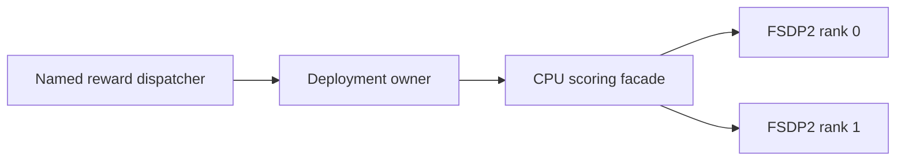

# FSDP2 reward model design

Last updated: 11/13/2026.

This design document is for developers maintaining reward execution, placement and lifecycle management.
It explains how a frozen reward model spans two GPUs within the existing named native reward interface.
For scorer configuration and the inference/scoring contract, see [Named Reward Models](../algo/named_reward_models.md).

## Supported deployment

The initial adapter supports pretrained PickScore with float32 inference, one node and one dedicated two-GPU
reward pool. It requires synchronous V1 diffusion training, one scoring facade and required reward terms.
Streaming, shared-GPU phase scheduling, additional adapters and trainable reward parameters are separate integrations.

`placement.replica_groups: [[0, 1]]` selects one logical replica with two ordered ranks in the parent reward pool.
Both indices must identify distinct GPU bundles. Flat `placement.devices` continues to select complete model replicas.
An omitted or null `fsdp` uses default deadlines for replica groups and leaves flat placement unchanged.

```yaml
trainer:
  use_v1: true
  v1:
    trainer_mode: sync
reward:
  num_workers: 1
  reward_model:
    enable: false
    enable_resource_pool: true
    nnodes: 1
    n_gpus_per_node: 2
  reward_manager:
    name: MultiVisualRewardManager
  models:
    pickscore:
      backend: native
      offload: true
      model_path: /path/to/PickScore_v1
      placement:
        replica_groups: [[0, 1]]
      executor:
        model: verl_omni.utils.reward_score.pickscore_reward:PickScoreNativeModel
        kwargs:
          processor_path: /path/to/clip_processor
      fsdp:
        timeout: 120
        collective_timeout: 30
  reward_functions:
    pickscore:
      path: pkg://verl_omni.utils.reward_score.pickscore_reward
      name: compute_score_pickscore_native
      required: true
```

The checkpoint must remain immutable across load/unload cycles. Both deadlines must be finite and positive.
Unsupported placement, executor and trainer settings are rejected before actor allocation.

## Execution and ownership



The facade presents one logical scoring worker to the existing dispatcher. It serializes complete batches across
the rank pair, so both ranks enter the same collective sequence. Each rank executes the same preprocessed inputs;
only rank zero publishes raw features. Existing reward functions retain score calculation and weighting.

The rank adapter uses the existing FSDP2 loading utilities and DTensor parameters. CLIP feature methods run inside
one managed forward boundary; root parameters are explicitly reshared after inference. Wake reloads the immutable
checkpoint. Sleep waits for accepted scoring to finish, then releases weights on both ranks.

The deployment owner retains rank handles and records the facade before its readiness RPC. This lets construction
rollback terminate actors even when the facade constructor or readiness check fails.

## Failure and shutdown contract

A rank error, timeout, partial submission or facade failure invalidates the whole replica. Cleanup attempts the
facade and both ranks even if one termination fails. A definite actor-death response is required for success;
temporary unavailability and timeout remain cleanup failures. Primary and cleanup errors are preserved together.
The failed replica is not retried or reused.

Concurrent close callers wait for the same owned termination to settle and observe its retained error. Cancelling
a caller does not release accepted work early. Waiting for the termination lock runs outside the event loop.
Trainer finalization closes reward resources and the transfer queue on both success and failure.

## Validation

The lightweight CPU contracts are in `tests/reward_loop/test_native_fsdp_integration_on_cpu.py`; they do not start
Ray or load model weights. Manual accelerator validators cover pretrained parity, constructor/readiness failures,
rank/facade faults and repeated load/unload. Cleanup checks retain actor IDs and require terminal states before
Ray shutdown. End-to-end SD3.5 training additionally checks finite gradients, changed LoRA tensors, exact Adam
counters and checkpoint continuation. These checks establish correctness for the exercised configuration.

Run from the repository root with local immutable checkpoints and two GPUs with sufficient free memory:

```bash
CUDA_VISIBLE_DEVICES='' "$PYTHON" -m pytest \
  tests/reward_loop/test_native_fsdp_integration_on_cpu.py -q --asyncio-mode=auto
CUDA_VISIBLE_DEVICES="$GPU_PAIR" "$PYTHON" -m tests.reward_loop.validate_native_fsdp \
  --model-path "$PICKSCORE_MODEL" --processor-path "$PICKSCORE_PROCESSOR" \
  --media-jsonl "$MEDIA_JSONL" --output "$PARITY_OUTPUT"
```
