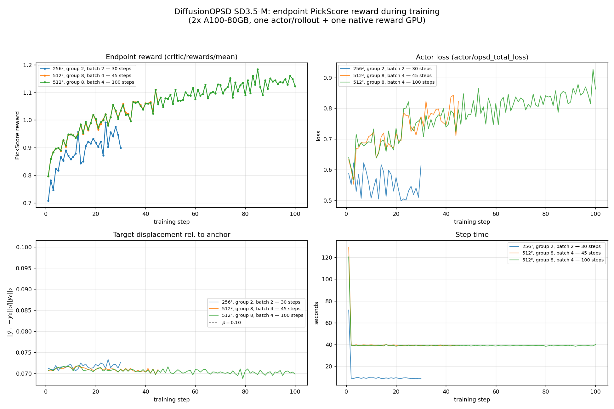
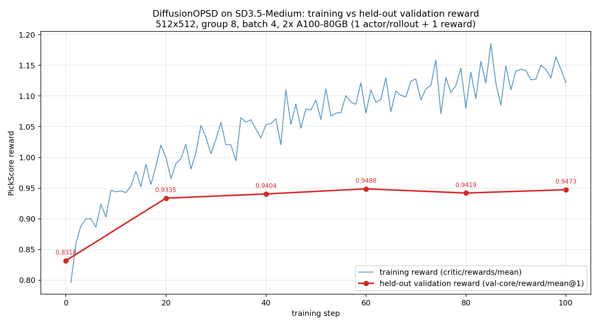

# DiffusionOPSD

Last updated: 10/19/2026.

DiffusionOPSD ([paper](https://arxiv.org/abs/2608.24646),
[code](https://github.com/worldbench/DiffusionOPSD)) is an online RL method for
diffusion models that turns an **image-level scalar reward** into **explicit
low-noise clean-output targets** and trains the policy to reproduce them. It is
an **on-policy self-distillation** method: the behavior policy is an exponential
moving average (EMA) of the trained policy itself, and every target is
constructed from a reward gradient evaluated at a clean-latent estimate of a
state the behavior policy actually visited. There is no teacher checkpoint, no
reward model in the actor loss, and no reverse-process likelihood.

## Background

Post-training a diffusion model with a scalar image reward is awkward because
the reward is only defined on decoded images while the policy acts on latents
through a long reverse process. Policy-gradient methods need rollout
likelihoods or ratio corrections; forward-process methods such as
[DiffusionNFT](diffusionnft.md) regress clean latents and use the reward only as
a sample weight, which commits the update to whatever the reward says about
already-generated samples.

DiffusionOPSD instead asks: *what would the reward say the clean output should
be?* At a low noise level the model's clean-output estimate
$\hat y_\sigma = z_\sigma - \sigma\, v_\theta(z_\sigma, c, \sigma)$ is close to
a real image, so a differentiable reward can be evaluated on it and
differentiated with respect to the latent. A few normalized gradient steps,
clipped to a small relative trust region, give an explicit target that increases
(resp. decreases) the reward. The actor then fits the policy to these
**detached** targets with the ordinary forward-process (flow-matching) loss,
without ever back-propagating through the reward.

This separates two effects that reward-only methods conflate: the *construction
gain* of the target (how much reward the bounded optimization step could add)
and the *realized gain* of the finite policy update that fits it. Because the
targets are computed per sample and detached, the actor loss stays a pure
regression problem and the reward graph is discarded at the end of target
construction.

## Algorithm (v1 recipe)

The first iteration of the paper (the v1 recipe implemented here) uses a
deterministic, CFG-free rollout, a single low-noise query state per trajectory,
two greedy reward-gradient steps per branch, and one optimizer update per outer
iteration.

### Query and anchor

For a prompt $c$, the frozen behavior policy $\pi_\text{old}$ — in VeRL-Omni,
the `old` LoRA adapter — generates a deterministic ODE trajectory. Let
$\{\sigma_j\}$ be the scheduler noise levels used by that rollout. The state

$$
z_q = z_{\sigma_q}, \qquad
\sigma_q = \arg\min_{\sigma_j} \left| \sigma_j - \sigma^\star \right|
$$

is recorded as the **query state**, with the constraint $k_q \ge 1$ so the query
is never the pure-noise start. The query noise $\sigma^\star$ is a
configuration value (paper v1: `0.278` for SD3.5-Medium, `0.273` for Z-Image).
The SD3.5 rollout adapter keeps only the trailing low-noise states (four steps
by default, which spans roughly $\sigma \in [0.56, 0]$ on the shift-3 schedule),
so $\sigma_q$ is resolved at runtime from that captured window: the state
closest to $\sigma^\star$ is selected, and the build fails if the closest
captured state is further than `opsd_query_sigma_tolerance` (`0.15`) from the
requested value. The selected scheduler timestep is stored in the batch with the
query latent.

The **anchor** is the behavior policy's clean-output estimate at the query:

$$
y_0 = z_q - \sigma_q\, v_\text{old}(z_q, c, \sigma_q),
$$

detached from the graph. $y_0$ is the starting point of target construction and
the center of the trust region.

### Bounded reward-gradient targets

Let $R$ be a differentiable reward and $D$ the VAE decoder, so that
$R(D(y), c)$ is a scalar image reward computed from a clean latent $y$. For a
direction $d \in \{+1, -1\}$ and $M_\text{tgt}$ steps, the target is built with

$$
B = \rho \left\lVert y_0 \right\rVert_2, \qquad
h = \frac{\eta\, B}{M_\text{tgt}},
$$

$$
y^{(m+1)} = y^{(m)} + d\, h\,
\frac{\nabla_{y} R\!\left(D\left(y^{(m)}\right), c\right)}
{\left\lVert \nabla_{y} R\!\left(D\left(y^{(m)}\right), c\right) \right\rVert_2 + \varepsilon_g},
$$

$$
y^{(m+1)} \leftarrow y_0
+ B\, \frac{y^{(m+1)} - y_0}
{\max\left(\left\lVert y^{(m+1)} - y_0 \right\rVert_2,\, B\right)} .
$$

The budget $B$ is **relative** to the anchor norm, not an element-wise clip, and
the projection keeps every iterate inside the L2 ball
$\lVert y - y_0 \rVert_2 \le B$. The ascent branch ($d = +1$) yields the positive
target $\bar y_+$ and the descent branch ($d = -1$) yields the negative target
$\bar y_-$. Both branches start from the same first reward gradient computed at
$y_0$, so a two-step target costs three reward-gradient backward passes per
target micro batch rather than four. The gradient norm epsilon
$\varepsilon_g = 10^{-12}$ is a numerical guard, not a tunable.

The v1 defaults are $\sigma^\star = 0.278$, $\rho = 0.10$, $M_\text{tgt} = 2$,
$\eta = 1.0$.

### Detached two-branch fit

At the same query state the actor evaluates its current velocity
$v_\theta(z_q, c, \sigma_q)$ and forms two implicit branch velocities against the
behavior policy:

$$
v_+ = \beta\, v_\theta + (1-\beta)\, v_\text{old}, \qquad
v_- = (1+\beta)\, v_\text{old} - \beta\, v_\theta,
$$

$$
y_{\theta+} = z_q - \sigma_q\, v_+, \qquad
y_{\theta-} = z_q - \sigma_q\, v_- .
$$

Only $v_\theta$ carries gradient; $v_\text{old}$ and the targets are detached.
With $\beta = 1.0$ the branches reduce to the current policy for the positive
branch and the reflection $2 v_\text{old} - v_\theta$ for the negative branch, as
in DiffusionNFT.

The regression uses a per-sample, stop-gradient adaptive normalizer

$$
\gamma_\pm = \max\left(
  \mathrm{sg}\!\left(\mathrm{mean}\left| y_{\theta\pm} - \bar y_\pm \right|\right),
  \varepsilon_\gamma
\right),
$$

where the mean runs over all non-batch latent dimensions and
$\varepsilon_\gamma = 10^{-5}$ (`opsd_eps_gamma`). The two branches are weighted
by the endpoint reward: with group means $\bar r_c$, the normalized reward
$\tilde r = (r - \bar r_c) / (\hat\sigma + 10^{-4})$ is clipped at
$\pm c_\text{adv}$ and mapped into $[0, 1]$,

$$
\omega = \frac{1}{2} + \frac{1}{2}\,
\mathrm{clip}\!\left(\frac{\tilde r}{c_\text{adv}}, -1, 1\right),
$$

and the actor loss is

$$
\mathcal{L}(\theta) = c_\text{adv}\,
\mathbb{E}\left[
\omega\, \frac{\mathrm{mean}\left( (y_{\theta+} - \bar y_+)^2 \right)}{\gamma_+}
+ (1-\omega)\, \frac{\mathrm{mean}\left( (y_{\theta-} - \bar y_-)^2 \right)}{\gamma_-}
\right].
$$

In VeRL-Omni the weight is produced by the same trainer-side helpers as
DiffusionNFT: `_compute_group_advantages` normalizes endpoint rewards per prompt
(with `algorithm.global_std=True` the standard deviation is the batch level one,
matching $\hat\sigma$), and `_advantage_to_reward_prob` applies the
$\pm c_\text{adv}$ clamp and the affine map. There is no PPO ratio, no clipping
of the policy ratio, no KL term, and no reference model. $c_\text{adv} = 5.0$
(`actor_rollout_ref.actor.diffusion_loss.adv_clip_max`) is **both** the reward
normalization scale and the loss scale; changing it changes the branch weights
$\omega$ and the loss magnitude at once, so it is not a plain learning-rate
knob. It does not affect target construction, which is governed by `opsd_rho`,
`opsd_n_ascent` and `opsd_eta`.

### Behavior-policy refresh and fit budget

After each outer iteration $u$ the behavior policy is refreshed from the trained
policy weights:

$$
\theta_\text{old} \leftarrow \eta_\text{beh}(u)\, \theta_\text{old}
+ \left(1 - \eta_\text{beh}(u)\right) \theta,
\qquad
\eta_\text{beh}(u) = \min\left\{10^{-3} u, 0.5\right\}.
$$

VeRL-Omni's `algorithm.old_policy_decay_schedule=linear_to_0_5` implements exactly
this schedule (decay $0$ at update $0$ means a copy, then the ramp capped at
$0.5$), and `algorithm.old_policy_update_interval=1` refreshes it once per
training step.

The fit budget is $M_\text{fit} = 1$: targets are constructed once per rollout
batch. The provided recipe sets `ppo_mini_batch_size` equal to
`data.train_batch_size` and leaves `ppo_epochs=1`, so the actor takes exactly one
optimizer step per target set.

The reference implementation additionally keeps a separate checkpoint EMA that
only affects saved/evaluated weights. That EMA is not part of this
implementation; checkpointing follows the normal LoRA path and there is no
separate evaluation-weight EMA.

## How VeRL-Omni Implements DiffusionOPSD

DiffusionOPSD reuses the online direct-preference stack of DiffusionNFT and
DGPO: the `old` LoRA adapter is the frozen behavior policy, the forward-process
engine computes old and current velocities, and the v1 trainer owns the loop.
The genuinely new runtime is reward-differentiable target construction, which
runs inside a dedicated `diffusion_opsd_model` engine so the target builder and
the policy forward step share one actor-worker placement.

| Layer | What it does | Code |
|---|---|---|
| Rollout adapter | Samples with the `old` adapter (deterministic, CFG-free) and keeps the trailing low-noise states and scheduler timesteps for query selection. | `verl_omni/pipelines/sd3_opsd/` |
| Target runtime | Loads a frozen fp32 VAE and the differentiable reward, decodes the anchor to pixels, and builds both trust-region targets; only target construction touches the reward graph. | `verl_omni/trainer/diffusion/opsd_target_runtime.py` |
| Target math | `opsd_anchor`, `build_positive_negative_targets`, `opsd_two_branch_loss` (shared first gradient, trust-region projection, adaptive normalizers). | `verl_omni/trainer/diffusion/opsd_targets.py` |
| Actor loss | Detached two-branch forward-process regression with adaptive normalizers and endpoint-reward weight. | `verl_omni/trainer/diffusion/diffusion_algos.py` (`OPSDLoss`) |
| FSDP engine | `diffusion_opsd_model`: old and current velocities at $(z_q, \sigma_q)$, plus the reward-gradient target construction inside the same forward step; the adapter feeds $(z_q, \sigma_q)$ as `xt`/`t_expanded` instead of re-noising. | `verl_omni/workers/engine/fsdp/diffusers_impl.py` (`OPSDDiffusersFSDPEngine`) |
| Trainer | v1 sync loop: rollout → reward → actor update (engine builds targets, loss fits them) → `old` adapter refresh. | `verl_omni/trainer/diffusion/v1/trainer_base.py` |

What is reused:

- The `old` LoRA adapter supplies *both* the behavior policy for the query and
  the branch reference velocity, so no second transformer checkpoint is loaded.
- The forward-process engine already computes old and current velocities for a
  per-sample objective; the OPSD engine builds the two targets inside the same
  forward step instead of adding a separate trainer stage.
- `_compute_group_advantages` / `_advantage_to_reward_prob` give the
  endpoint-reward weight, so the training reward curve is the same reward the
  reward stack already reports.
- The v1 sync trainer and its batch/replay machinery are unchanged; target
  construction happens inside the actor update, before the current-policy
  forward pass, and batch preparation selects the query state and builds the
  endpoint-reward weight.

### Target runtime

`OPSDTargetRuntime` is the only module that sees the reward/decoder graph:

- It loads the frozen VAE from the actor checkpoint's `vae/` subfolder in fp32,
  runs it in eval mode with gradient checkpointing, and applies the SD3.5
  scaling/shift factors before the `[-1, 1] -> [0, 1]` clamp.
- It loads the frozen differentiable PickScore in `opsd_reward_dtype` and
  reimplements the CLIP resize/center-crop/normalize step with torch ops. The
  stock Hugging Face processor converts tensors to PIL images, which would cut
  the reward graph before the VAE.
- Prompts are the token ids already present in the actor batch; the runtime
  decodes them with the checkpoint's `tokenizer/` tokenizer and re-tokenizes
  them with the reward's own processor.
- Target construction runs on `opsd_target_micro_batch` rows at a time, stops
  gradient tracking after producing the detached targets, and returns
  `opsd_target_pos` / `opsd_target_neg` plus relative-displacement diagnostics.
  The actor update only sees the detached targets.

### Differences from the reference implementation

- The behavior-policy EMA is refreshed once per training step, not once per
  optimizer step; the fit budget is one update per step, which makes the two
  equivalent for this recipe.
- The checkpoint EMA used for saving/evaluation in the reference code is not
  implemented.
- The query state is selected from the last four rollout states by
  $\arg\min |\sigma_j - \sigma^\star|$; a requested query level more than
  `opsd_query_sigma_tolerance` away from every captured state raises at batch
  preparation instead of training on a wrong-noise state.
- The reference recipe samples $K = 24$ images per prompt; the provided example
  uses a smaller group first (see the [example README](../examples/diffusionopsd_trainer.md)).
- The reference main branch also ships a v2 acceleration (query-prefix rollout,
  $M_\text{tgt} = 1$, neutral weight, $K = 1$). Only the v1 recipe is
  implemented.

## Configuration

DiffusionOPSD requires the online direct-preference loop, the `old` LoRA
adapter, and the forward-process engine entry:

```bash
algorithm.trainer_type=direct_preference
algorithm.sample_source=online
actor_rollout_ref.model.algorithm=opsd
actor_rollout_ref.model.model_type=diffusion_opsd_model
actor_rollout_ref.actor.diffusion_loss.loss_mode=opsd
actor_rollout_ref.model.policy_state_adapters='["default","old"]'
actor_rollout_ref.rollout.rollout_adapter=old
actor_rollout_ref.rollout.calculate_log_probs=False
trainer.use_v1=true
trainer.v1.trainer_mode=sync
```

### Core parameters

The `opsd_*` fields live on `actor_rollout_ref.actor.diffusion_loss`.

- `opsd_rho` (default `0.10`): relative L2 trust-region radius $\rho$; the
  per-sample budget is $\rho \lVert y_0 \rVert_2$.
- `opsd_n_ascent` (default `2`): number of reward-gradient steps $M_\text{tgt}$
  per branch. The first step's gradient is shared between the positive and
  negative branches.
- `opsd_eta` (default `1.0`): fraction $\eta$ of the budget consumed per ascent
  step, before projection.
- `opsd_branch_beta` (default `1.0`): $\beta$ in the implicit positive/negative
  velocities.
- `opsd_query_sigma` (default `0.278`): target noise level $\sigma^\star$. The
  query step is chosen at runtime by closest scheduler noise.
- `opsd_query_sigma_tolerance` (default `0.15`): maximum allowed gap between
  the requested $\sigma^\star$ and the closest captured rollout state. The
  rollout adapter keeps a short trailing window of low-noise states (four steps,
  `StableDiffusion3OPSDPipeline.query_window_steps`); if $\sigma^\star$ is not
  inside that window, batch preparation raises instead of silently training on
  the nearest edge state.
- `opsd_num_train_timesteps` (default `1000`): scheduler train-timestep scale
  used to map scheduler timesteps to flow time ($\sigma = t / N_\text{train}$)
  when selecting the query state. It must match the policy scheduler's
  `num_train_timesteps` (SD3.5's flow scheduler uses `1000`).
- `opsd_eps_gamma` (default `1e-5`): minimum adaptive normalizer
  $\varepsilon_\gamma$.
- `opsd_reward_kind` (default `pickscore`): differentiable reward used only for
  target construction. PickScore v1 is the only kind implemented in this PR;
  other values fail when the target runtime is built.
- `opsd_reward_model_path` (default empty): checkpoint for the differentiable
  reward. Empty selects the PickScore v1 default checkpoint.
- `opsd_reward_dtype` (default `float32`): dtype of the differentiable reward
  model used during target construction. `float32` is the validated choice for
  a stable reward gradient; lower precision is allowed by the config but not
  validated.
- `opsd_target_micro_batch` (default `6`): number of samples per reward-backward
  micro batch during target construction; the main peak-memory knob for the
  stage.

The loss scale and endpoint-weight clamp are the shared
`actor_rollout_ref.actor.diffusion_loss.adv_clip_max` ($c_\text{adv}$).
Endpoint weights are normalized with `algorithm.global_std` (batch-level reward
std, as in the paper) and `algorithm.norm_adv_by_std_in_grpo`.

### Behavior-policy and trainer flags

- `algorithm.old_policy_decay_schedule=linear_to_0_5`: implements
  $\eta_\text{beh}(u) = \min(10^{-3} u, 0.5)$.
- `algorithm.old_policy_update_interval=1`: refresh the `old` adapter every
  training step.
- `trainer.use_v1=true` + `trainer.v1.trainer_mode=sync`: the v1 synchronous
  trainer is currently the only supported loop.
- `actor_rollout_ref.rollout.algo.noise_level=0.0`: deterministic rollout, so
  the query state is on the behavior policy's ODE trajectory.

### Reward wiring

The **endpoint** reward, used only to compute the group-normalized weight
$\omega$ and for monitoring, goes through the usual reward stack. The example
wires the native PickScore named model
(`reward.models.pickscore` with
`verl_omni.utils.reward_score.pickscore_reward:PickScoreNativeModel` and
`compute_score_pickscore_native`). The **differentiable** reward used for target
construction is a separate module loaded by the `diffusion_opsd_model` engine,
selected by `opsd_reward_kind`/`opsd_reward_model_path`. Both must load the same
checkpoint so the weights and the targets refer to the same reward. A CPU
alignment check on the same batch measured the differentiable target reward at
0.634889 vs the native endpoint reward at 0.633521 ($|\Delta| = 0.001369$, 0.22%
relative); pixel-level preprocessing differs by design (differentiable bicubic vs
PIL resize, mean $|\Delta| = 0.005$).

## Metrics

- `actor/opsd_pos_loss`, `actor/opsd_neg_loss`, `actor/opsd_policy_loss` and
  `actor/total_loss`: the two detached branches and the combined actor loss.
- `actor/opsd_reward_prob_mean`: mean positive-branch weight $\omega$ over the
  batch; it should hover near `0.5` when the endpoint rewards are balanced.
- `actor/opsd_query_sigma`: the selected query noise level $\sigma_q$ (flow time).
  Check it against `opsd_query_sigma`; a value pinned at the captured-window edge
  means the rollout adapter's trailing window is too narrow for the schedule.
- Target construction returns `opsd_target_displacement_rel` and
  `opsd_target_displacement_neg_rel`, the mean relative displacement of each
  target from the anchor. The positive value must lie in $(0, \rho]$; a value
  pinned at $\rho$ means the projection is active on every sample, and a value
  near zero means the reward gradient is not reaching the target runtime. The
  helper also exposes `budget_rel`, `anchor_norm_mean`, `target_pos_norm_mean`,
  `target_neg_norm_mean` and `first_grad_norm_mean` in its diagnostics dict.
- `critic/rewards/mean` (endpoint training reward; the policy-gradient trainers
  report the same value as `critic/score/mean`) and the validation reward
  remain the primary learning curves, as for DiffusionNFT and DGPO.

## Relationship to other methods

DiffusionOPSD is **not** on-policy distillation (OPD). Despite the name, there is
no external teacher:

| Method | Supervision | Behavior policy | Trained objective |
|---|---|---|---|
| [DiffusionOPD](diffusion_opd.md) | A frozen teacher's per-step transition mean, KL between student and teacher | Student policy | Teacher-student KL (dense, per-step) |
| [DiffusionNFT](diffusionnft.md) | Endpoint clean latents re-noised at sampled timesteps | `old` EMA policy | Forward-process regression weighted by reward optimality probability |
| DiffusionOPSD (this page) | Explicit bounded clean-output targets built from a differentiable reward gradient at a low-noise on-policy query | `old` EMA policy | Detached two-branch regression to reward-gradiented targets |

Compared with [DGPO](dgpo.md), DiffusionOPSD has no group-level preference
score, no old-policy ratio, and no ratio clipping; the group only supplies the
endpoint-reward normalization. Compared with DMD2-style distillation, the target
comes from a reward gradient, not from a model score difference.

## Limitations

- **Backbone:** SD3.5-Medium only. Other diffusion backbones (including
  Z-Image) are not wired.
- **Parameters:** LoRA only. The behavior policy is an adapter-level EMA;
  full-weight training is not supported.
- **Loop:** online `direct_preference` on the v1 `sync` trainer only. The legacy
  v0 trainer and the `separate_async` mode are not supported.
- **Reward:** one differentiable reward per run. Only PickScore v1 is
  implemented by the target runtime; other reward kinds are rejected.
- **Query window:** the SD3.5 rollout adapter keeps the last four denoising
  states, so $\sigma^\star$ must fall inside that window (it does for the
  SD3.5-Medium 10-step schedule). Widening the window or changing the requested
  $\sigma^\star$ beyond `opsd_query_sigma_tolerance` fails at startup of the
  first batch rather than silently changing the query level.
- **Validation status:** validated on two A100-80GB GPUs (one actor/rollout, one
  native reward) at 512x512 with 100 optimizer steps, group size 8 and 4 prompts
  per update. The endpoint PickScore reward rose from **0.797 to 1.122 (+41%)**,
  peaking at 1.184, with `opsd_target_displacement_rel` in [0.0688, 0.0718]
  (inside the trust region), 39.8 s per step after warm-up, **61.6 GB peak VRAM**
  on the actor/rollout GPU and 4.8 GB on the reward GPU, and no non-finite
  gradients. A 30-step 256x256 smoke run (0.707 -> 0.899) and a 45-step 512x512
  run (0.797 -> 1.066) are consistent with it.
- **Held-out validation:** the same 512x512 configuration with
  `trainer.test_freq=20` and `val_before_train=True` raises the validation
  PickScore from **0.832 to 0.947 (+13.9%)** over 100 steps, so the gain is not
  training-set only. Validation plateaus after roughly 60 steps while the
  training reward keeps climbing.
- **Recipe fidelity:** the example still uses a smaller rollout group than the
  paper's $K = 24$ (8 instead of 24) and 4 prompts per update instead of 48, so
  the absolute numbers are not comparable to the paper's reported scores.



Endpoint reward, actor loss, relative target displacement and step time for the
256×256 30-step smoke run, the 512×512 45-step run and the 512×512 100-step run.
The reward rises throughout training while the relative target displacement
stays just under $\rho = 0.10$, which is the intended trust-region behaviour:
the targets stay bounded and the policy keeps fitting them.



Training reward (blue) against the held-out validation reward (red, annotated) for
the 512×512 100-step run. Validation rises from 0.832 to 0.947 and then plateaus
around step 60, while the training reward keeps increasing.

## Reference Example

[`examples/diffusionopsd_trainer/sd35/run_sd35_medium_opsd_lora_v1.sh`](https://github.com/verl-project/verl-omni/blob/main/examples/diffusionopsd_trainer/sd35/run_sd35_medium_opsd_lora_v1.sh)
post-trains `stabilityai/stable-diffusion-3.5-medium` with LoRA on PickScore-SFW
prompts. It rolls out deterministically at 512×512 with 10 steps and guidance
scale `1.0`, queries at $\sigma^\star = 0.278$, and uses the native PickScore
named reward for the endpoint weight. See the
[example README](../examples/diffusionopsd_trainer.md) for data preparation and
launch instructions.
