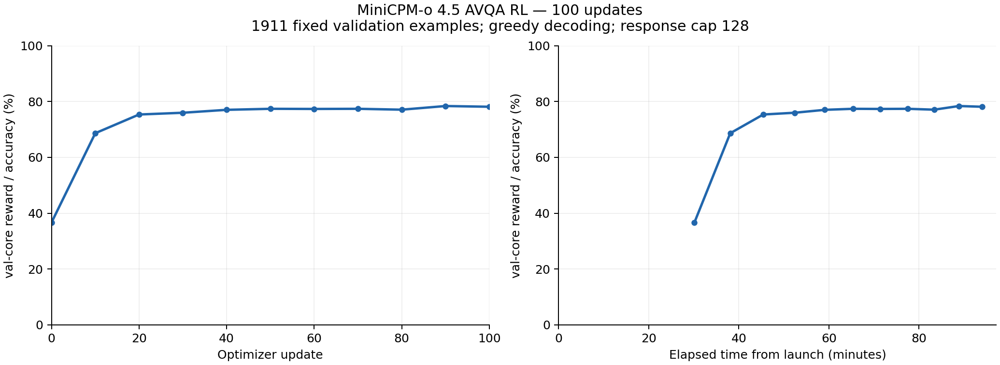

# MiniCPM-o 4.5 Megatron AVQA validation

Last updated: 11/17/2026

Eight H200 GPUs; TP4 language-model actor with frozen audio/vision towers and
projectors; two standalone TP2 rollout replicas. The separate-async runtime
also initializes colocated rollout replicas and checkpoint-transfer workers.
GRPO advantages, GSPO loss, clipping 0.0003/0.0004, two samples per prompt,
four prompts per update, learning rate 1e-6, response cap 128, greedy validation,
reference KL disabled. This validates image/audio understanding, not speech generation.

- 100 optimizer updates, 800 training outputs.
- 11 validations at steps 0, 10, ..., 100; 1,911 outputs each (21,021 total).
- All saved outputs independently regraded with the choice reward: zero discrepancies.
- Accuracy 36.68% → 78.13%; best 78.39% at step 90.
- 92 scalar tags finite. All 56 exact-zero gradient steps had tied rewards
  within every sampled group; they are retained rather than counted as nonzero updates.
- Rollout/actor probability Pearson correlation 0.986897–0.995699;
  maximum observed trajectory lag 1. This does not prove numerical parity.
- Wall time 5,668.616 seconds, including initialization, validation and teardown.
- Exit 0, no signals sent; independent host check confirmed eight GPUs and the
  coordination lock released. During teardown, two previously verified GPU PIDs
  became unreadable before exit; the raw observation is retained, so continuous
  shutdown identity was not established.

`validation.csv` contains every validation point and generation-file SHA256.
`summary.json` contains the audited diagnostics; `runtime.json` identifies the
actual development stack and tested integration hashes. Raw logs, resolved config,
TensorBoard and generations were archived: 137 files / 34,697,307 bytes,
manifest SHA256 `aff05700481e48d19420406bbe756a685e9b843d7e519a6c51a0f1e002e68ede`.
Raw media, model weights and internal paths are not included here.

## Limits and merge prerequisites

This is a single seed with development dependency overrides. The run used the
Nov 9 base plus this integration; it does not qualify the later rebased head or
current public dependency pins end to end. The merged Bridge model requires
builder-based construction in verl, which is still absent from the current
public pin. No dependency pin or CI configuration is changed here.

Bucketed weight synchronization emitted `Vision missing` / `APM missing` warnings;
those observations remain recorded and are not described as warning-free loading.
Validation mean response length fell from 395.06 to 172.29 characters while reward
and parseability improved. With a 128-token cap and no length objective, this run
cannot establish that shortening is resolved or that longer reasoning is preserved.
No independent held-out or multi-seed quality claim is made. Input/ground-truth
multiset equality across validations does not independently establish media identity.
