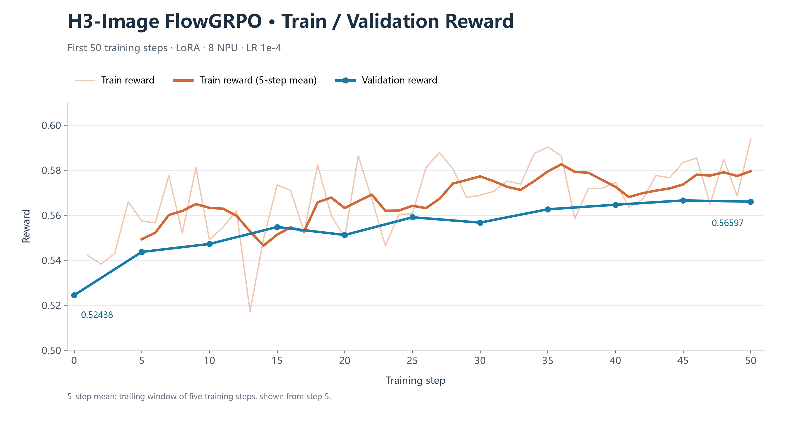

# MiniMax H3 Image FlowGRPO

Last updated: 11/17/2026.

This integration pairs Diffusers' native `MiniMaxH3ImageTransformer2DModel`
with vLLM-Omni's `MiniMaxH3ImagePipeline` on the released six-step PDD grid.
It reuses the existing H3 tokenizer, LoRA mapping, and FlowGRPO scheduler and loss.

The scope is text-to-image LoRA training with Actor sequence parallelism 1.
No checkpoint conversion, external source patch, or replacement actor kernel
is required. Accelerator numerical alignment and end-to-end training for this
native implementation remain unverified; the earlier patched runs are not its
validation evidence.

See the [recipe and installation requirements](../../../examples/flowgrpo_trainer/minimax_h3_image/README.md).

## Earlier experiment: first 50 steps

Historical run with the earlier patched implementation: LoRA on 8 NPUs,
learning rate 1e-4, evaluation before training and every five steps. Validation
reward increased from 0.52438 to 0.56597 at step 50. This figure provides
experimental context; it does not validate the native implementation above.
