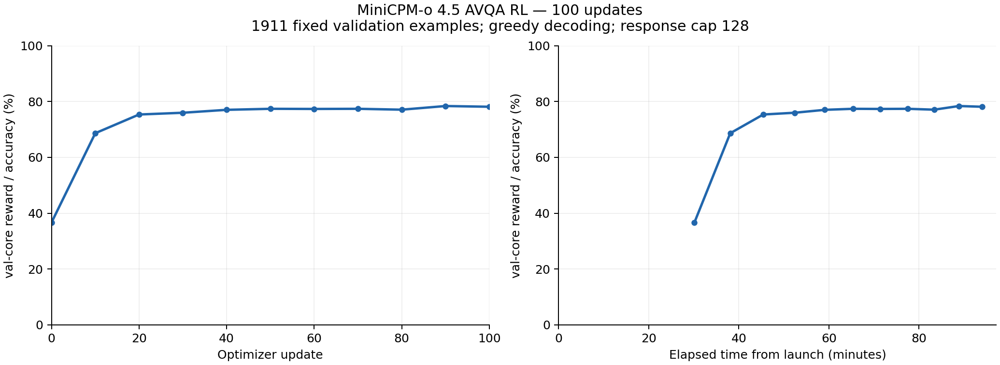

# MiniCPM-o 4.5 understanding with Megatron

The Megatron entry reuses the registered MiniCPM processor, AVQA dataset, rollout
adapter, and choice reward. It trains the dense Qwen3 language decoder, keeping
the vision/audio encoders and projectors frozen. It excludes speech generation.

The 4.5 processor follows the checkpoint’s non-streaming chat format: content
blocks are separated by newlines, and audio input selects its audio-answer
template. This does not enable speech generation. Explicit template kwargs
remain overridable; older checkpoint versions retain their existing rendering.

The integration requires Megatron-Bridge's `MiniCPMOModelConfig` builder and a
verl revision with builder-based model construction. Installing the pre-existing
MiniCPM FSDP recipe alone does not provide these prerequisites.

## Dependency status

Megatron-Bridge support is merged in [NVIDIA-NeMo/Megatron-Bridge#6630](https://github.com/NVIDIA-NeMo/Megatron-Bridge/pull/6630).
The current public verl pin still uses the provider-only construction path; it
needs the builder integration used by this experiment before this entry works
from the default install. This PR does not vendor or monkey-patch verl.
The tested revisions and integration hashes are recorded in
[`runtime.json`](../../../docs/evidence/minicpmo-megatron-100step-20261116/runtime.json).
This is not clean-public-pin E2E qualification.

## One-update check

Prepare real AVQA-R1 media and parquet with the existing AVQA data script. Then,
from the repository root on a machine with eight available GPUs:

```bash
MODEL_PATH=/path/to/MiniCPM-o-4_5 \
TRAIN_FILE=/path/to/avqa/train.parquet \
VAL_FILE=/path/to/avqa/validation.parquet \
OUTPUT_DIR=/path/to/new-run \
bash examples/gspo_trainer/minicpm/run_minicpmo_4_5_thinker_gspo_megatron_avqa.sh
```

This is a functional smoke recipe: eight real training questions, four validation
questions, two responses per training question, and one optimizer step. Validation
runs before and after training. It does not measure learning quality or throughput.
The smoke check disables the multimodal processor cache and uses an in-process
DataLoader. Confirm that all four validation outputs are present after each
weight synchronization; a completed process alone is not sufficient.
The response budget is 128 tokens; check truncation before reusing it for a longer
run. Hydra overrides are accepted as trailing arguments.

The recipe uses TP4 for the actor and two standalone TP2 rollout replicas. The
separate-async runtime also initializes and sleeps its colocated rollout replicas.
The rollout memory fraction is 0.4 to leave room for the colocated actor.
It keeps old/current logprob microbatches at one, uses the standard GSPO clipping
bounds, and leaves reference KL disabled. The distributed optimizer is enabled.
Dense attention and disabled gradient-accumulation fusion make the first check
independent of fused-attention and APEX gradient-fusion extensions.

Supported here: MiniCPM-o **4.5**, thinker stage, dense batches, TP, and PP=CP=1.
SP, packed sequences, MTP, quantized execution and Megatron LoRA are not supported
by this entry. The existing FSDP LoRA launchers remain separate.

For configuration inspection without GPU training, append `--cfg job --resolve`.
Check resolved settings and dependency versions before expanding the run.

## 100-update validation

The same entry was exercised on eight H200 GPUs with 4,435 training questions
and all 1,911 validation questions. The 100-step extension keeps the smoke
recipe's model settings, GSPO clipping, frozen towers and 128-token response cap:

```bash
MODEL_PATH=/path/to/MiniCPM-o-4_5 \
TRAIN_FILE=/path/to/avqa/train.parquet \
VAL_FILE=/path/to/avqa/validation.parquet \
OUTPUT_DIR=/path/to/new-run \
bash examples/gspo_trainer/minicpm/run_minicpmo_4_5_thinker_gspo_megatron_avqa.sh \
  data.train_max_samples=-1 data.val_max_samples=-1 \
  trainer.total_training_steps=100 trainer.total_epochs=2 trainer.test_freq=10
```

Validation accuracy increased from **701/1911 (36.68%)** to
**1493/1911 (78.13%)**. All 11 full validations and 800 training outputs passed
independent choice-reward regrading. Wall time was 94.48 minutes, including
initialization, validation and teardown; this is not actor-only throughput.



[Full results and limitations](../../../docs/evidence/minicpmo-megatron-100step-20261116/README.md).
This is one seed under development dependencies, not a comparative benchmark.
